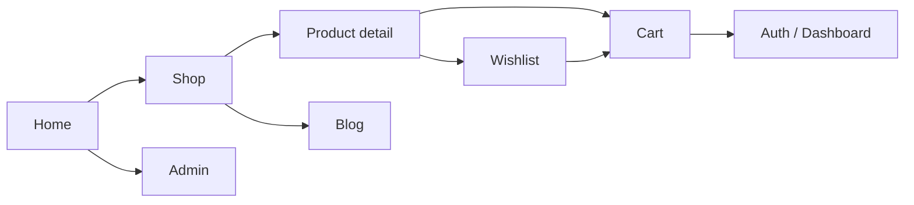

<a id="top"></a>
<p align="center">
  
</p>

<p align="center">
  
</p>

<p align="center">
  <a href="https://thread-co-e-commerce-rose.vercel.app"></a>
  <a href="https://github.com/shahidabuali/Thread-co-E-COMMERCE-"></a>
  <a href="https://github.dev/shahidabuali/Thread-co-E-COMMERCE-"></a>
  <a href="https://github.com/shahidabuali/Thread-co-E-COMMERCE-/issues/new"></a>
  <a href="https://shahidas-portfolio.vercel.app/"></a>
  <a href="https://www.linkedin.com/in/shahidabuali/"></a>
</p>

<p align="center">
  
  
  
  
</p>

## 📑 Contents

[The pitch](#pitch) · [Take the tour](#tour) · [Features](#features) · [Page flow](#flow) · [Run locally](#run) · [Author](#author)

<a id="pitch"></a>
## 🧵 The pitch

A complete fashion e-commerce **front-end** — storefront, product pages, cart, wishlist, blog, auth and an admin dashboard — built with plain HTML, CSS and JavaScript during my early practice days. No frameworks, no build step: just the browser doing the work.

<a id="tour"></a>
## 🗺️ Take the tour

| Page | What to look for |
| --- | --- |
| [index.html](index.html) | Animated hero, rotating headline, count-up stats, category grid, product cards |
| [shop.html](shop.html) | Search, category filters, sorting, skeleton loading cards |
| [product.html](product.html) | Colour/size pickers, quantity, add to cart, wishlist |
| [cart.html](cart.html) | Quantity updates, totals, promo code `THREAD20` |
| [wishlist.html](wishlist.html) | Saved items, move to cart |
| [auth.html](auth.html) / [dashboard.html](dashboard.html) | Demo sign-in and account area |
| [admin.html](admin.html) / [blog.html](blog.html) | Admin panel and blog layout |
| [emailservice.js](emailservice.js) | Email helper used by the demo flows |

<a id="features"></a>
<details>
<summary>✨ Interaction checklist — click to expand</summary>

- [x] Dark / light theme toggle, saved to `localStorage`
- [x] Animated SVG "dressing" figure that adds jacket → shoes → accessories in a loop
- [x] Hero headline that cycles through *Bold Story / True Self / Daily Mood*
- [x] Count-up counters, scroll reveals and skeleton placeholders
- [x] 12 products across 5 categories, with ratings, badges and low-stock warnings
- [x] Cart and wishlist persisted in `localStorage` (`tc_cart`, `tc_wishlist`, `tc_user`, `tc_theme`)
- [x] Toast notifications for add-to-cart, wishlist and newsletter actions
- [x] Newsletter signup and a promo-code banner

</details>

<a id="flow"></a>
<details>
<summary>🏗️ How the pages connect — click to view the diagram</summary>



</details>

<a id="run"></a>
<details>
<summary>▶️ Run it locally — click for commands</summary>

```bash
# simplest: double-click index.html
# or serve it locally:
python -m http.server 8000
# then open http://localhost:8000/index.html
```

Everything is demo data inside `index.html` — no database or payment gateway is connected.

</details>

<p align="center">
  
  
  
</p>

<a id="author"></a>
<p align="center">Built with patience and a lot of practice by <a href="https://github.com/shahidabuali">Shahida Bu Ali</a> · <a href="https://shahidas-portfolio.vercel.app/">Portfolio</a> · <a href="https://www.linkedin.com/in/shahidabuali/">LinkedIn</a></p>

<p align="center"><a href="#top">↑ Back to top</a></p>
