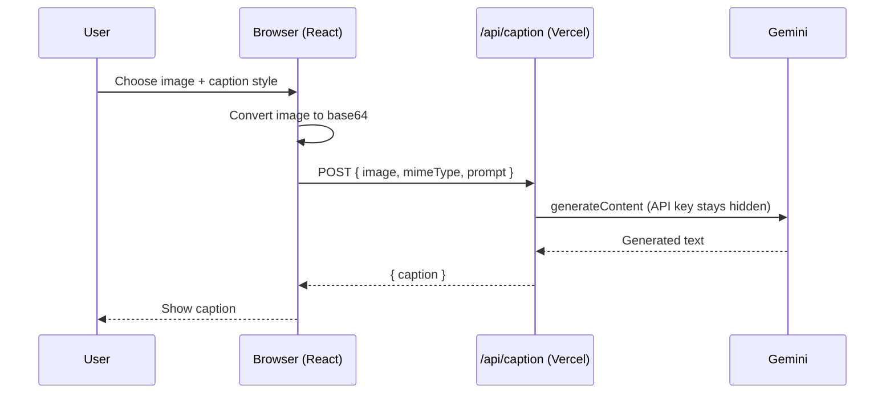

<a id="top"></a>
<p align="center">
  
</p>

<p align="center">
  
</p>

<p align="center">
  <a href="https://github.com/shahidabuali/Ai-Image-TO-Captions"></a>
  <a href="https://github.dev/shahidabuali/Ai-Image-TO-Captions"></a>
  <a href="https://vercel.com/new/clone?repository-url=https%3A%2F%2Fgithub.com%2Fshahidabuali%2FAi-Image-TO-Captions"></a>
  <a href="https://github.com/shahidabuali/Ai-Image-TO-Captions/issues/new"></a>
  <a href="https://shahidas-portfolio.vercel.app/"></a>
  <a href="https://www.linkedin.com/in/shahidabuali/"></a>
</p>

<p align="center">
  
  
  
  
</p>

## 📑 Contents

[The pitch](#pitch) · [Caption styles](#styles) · [Privacy notes](#privacy) · [Request flow](#flow) · [Project map](#map) · [Run locally](#run) · [Author](#author)

<a id="pitch"></a>
## ⚡ The pitch

Drop in a photo and get an instant AI-written caption. No account, no upload history, no paywall. Pick the style you need and click **Generate caption**.

<a id="styles"></a>
## 🎛️ Three caption styles

| Style | What it writes |
| --- | --- |
| **plain** | One accurate sentence describing the image |
| **alt** | Concise alt text for screen readers, under 20 words |
| **caption** | A short, casual social-media caption without hashtags |

<a id="privacy"></a>
<details>
<summary>🔒 Privacy & free-tier notes — click to expand</summary>

- JPG, PNG and WEBP images are supported. The image is converted to base64 in the browser and sent straight to Gemini — **the app never saves it**.
- The API runs on Gemini's free tier, so a busy day can temporarily exhaust the quota. If generation fails, try again in a few minutes.
- The optional waitlist writes an email to a Supabase `waitlist` table using a **publishable** key (safe for the browser). Secret keys stay server-side.

</details>

<a id="flow"></a>
<details>
<summary>🏗️ The request flow — click to view the diagram</summary>



</details>

<a id="map"></a>
<details>
<summary>🧩 Project map — click to expand</summary>

```
src/
  pages/     Home, About, Contact, Waitlist, ThankYou, NotFound
  components/ Nav, Breadcrumbs, CookieConsent
  supabaseClient.js
  App.jsx    routes + dark/light theme
api/
  caption.js Gemini proxy (POST only)
```

Extra polish: React Router pages, React Helmet SEO tags, breadcrumbs, cookie consent, collapsible FAQs and a custom 404 page.

</details>

<a id="run"></a>
<details>
<summary>▶️ Run it locally — click for commands</summary>

```bash
npm install
npm run dev
# npm run build  → production bundle
```

Add `GEMINI_API_KEY` in Vercel project settings (or `.env.local` when using `vercel dev`). It is read only inside `api/caption.js` — never expose it with a `VITE_` prefix.

For the optional waitlist, copy `.env.example` to `.env.local` and add your own `VITE_SUPABASE_URL` and `VITE_SUPABASE_ANON_KEY`. No real keys are stored in this repo; the waitlist simply shows a friendly message when they are missing.

</details>

<p align="center">
  
  
  
</p>

<a id="author"></a>
<p align="center">Built by <a href="https://github.com/shahidabuali">Shahida Bu Ali</a> · <a href="https://shahidas-portfolio.vercel.app/">Portfolio</a> · <a href="https://www.linkedin.com/in/shahidabuali/">LinkedIn</a></p>

<p align="center"><a href="#top">↑ Back to top</a></p>
